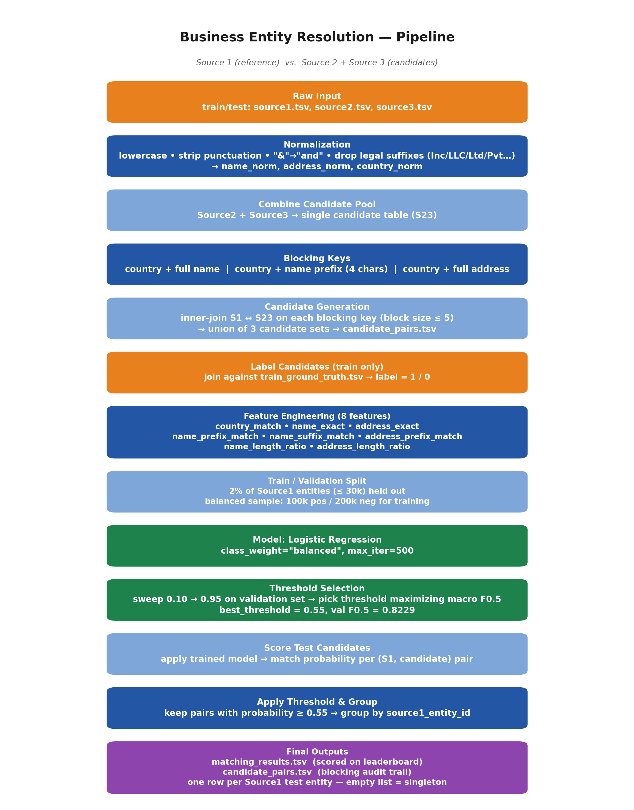

# Business Entity Resolution — Methodology Documentation

**Team:** `Code Orbit`
**Authors:** Jayasamvarthni V, Madhu Parameswari Ganesan, Kavinila N
**Challenge:** Amazon ML Challenge — Business Entity Resolution

---

## 1. Problem Summary

Given business records from three independent sources (Source 1 = deduplicated
reference, Source 2 and Source 3 = candidate pools) with noisy, inconsistent
`business_name` and `business_address` fields across US, India, and (test-only)
France, the task is to determine — for every Source 1 entity — which Source 2/3
records refer to the same real-world business. Evaluated with a precision-heavy
macro-averaged **F0.5** score, where correctly predicting "no match" (a singleton)
is worth full credit and false merges are penalized twice as heavily as missed
matches.

---

## 2. Pipeline Overview

The pipeline has three phases: **(1)** deterministic normalization and blocking
that produces a bounded, high-recall candidate set; **(2)** a small supervised
classifier trained only on those candidates that scores each pair's match
probability; **(3)** a validation-tuned decision threshold that converts
probabilities into the final match lists.

---

## 3. Methodology

### 3.1 Normalization

All three sources are normalized before anything else:

- **Names:** lowercased, punctuation stripped, `&` expanded to `and`, and
  trailing legal suffixes (`Inc`, `LLC`, `Ltd`, `Limited`, `Corp`, `Corporation`,
  `Company`, `Co`, `Pvt`, `Plc`) removed only when they appear at the end of the
  string, so the entity's core name survives suffix inconsistencies
  (`Corp` vs. `Corporation`, `Pvt` vs. `Private Limited`, etc.) without over-stripping.
- **Addresses:** lowercased and punctuation-stripped only — components are left
  in their original order, since reordering is handled downstream by the
  prefix/length features rather than by re-parsing address structure.
- **Country:** lowercased and punctuation-stripped, and treated throughout as an
  open string label. Nothing in the pipeline hard-codes `{US, India}`, so the
  test-only `France` label is handled identically to a country seen in training.

### 3.2 Candidate Generation / Blocking Strategy

Source 2 and Source 3 are concatenated into one candidate pool per split (train
and test are processed identically). Three blocking keys are built, each scoped
by normalized country to avoid cross-country collisions:

1. `country + full normalized name` — catches exact-name matches within a country.
2. `country + first 4 characters of the normalized name` — recovers matches where
   the tail of the name is corrupted by typos, DBA suffixes, or word-order changes.
3. `country + full normalized address` — recovers matches where the name has
   diverged more than the address (e.g. trade names vs. legal names).

For each key, Source 1 is inner-joined against the candidate pool restricted to
blocks whose size on the candidate side is between 1 and 5 — capping block size
keeps pairwise blowup tractable on multi-million-row sources while still letting
a Source 1 entity match zero, one, or several candidates. The union of the three
key-based joins (deduplicated) is the final candidate set, written out as
`candidate_pairs.tsv`. This is exactly the set the model scores at inference
time — nothing is filtered out of it afterward except by the model + threshold.

On the training split, every candidate pair is labeled 1/0 by joining against
`train_ground_truth.tsv` (exploded from comma-separated match lists), which lets
blocking recall be measured directly against ground truth before any modeling.

### 3.3 Model Architecture and Feature Engineering

**Model:** `LogisticRegression(class_weight="balanced", max_iter=500)` from
scikit-learn (BSD-3-Clause license, well under the 8B-parameter limit). A linear
model was chosen because the 8 features below are individually strong, mostly
binary/ratio signals that don't require deep interaction modeling, and because
a simple, well-calibrated model is easy to threshold precisely — important for
an F0.5 metric that punishes over-matching.

**Features (8, all computed pairwise between a Source 1 record and a candidate):**

| # | Feature | What it captures |
|---|---|---|
| 1 | `country_match` | Exact match on normalized country |
| 2 | `name_exact` | Exact match on normalized business name |
| 3 | `address_exact` | Exact match on normalized address |
| 4 | `name_prefix_match` | First 4 characters of normalized name match |
| 5 | `name_suffix_match` | Last 4 characters of normalized name match |
| 6 | `address_prefix_match` | First 8 characters of normalized address match |
| 7 | `name_length_ratio` | `min(len)/max(len)` of the two normalized names |
| 8 | `address_length_ratio` | `min(len)/max(len)` of the two normalized addresses |

Name and address are each covered by an exact-match, a partial-match, and a
length-similarity feature, so a pair with a corrupted tail or a reordered
address component can still surface strong partial signal even when the exact
match fails.

**Training sample:** ~2% of Source 1 training entities (capped at 30,000) are
held out entity-wise as a validation split, so no Source 1 entity contributes
candidate pairs to both training and validation. From the remaining candidates,
a class-balanced sample (up to 100,000 positives / 200,000 negatives) is drawn
for training — the raw candidate set is highly imbalanced toward negatives, and
balancing plus `class_weight="balanced"` keeps the model from defaulting to
"never match."

### 3.4 Threshold Selection

Match probability alone doesn't produce a submission-ready match list — a
decision threshold does. The trained model scores every validation candidate
pair, then thresholds from **0.10 to 0.95 in steps of 0.05** are swept; at each
threshold, predicted match sets are compared against true match sets **per
Source 1 entity**, and per-entity F0.5 is computed with singletons scored
correctly:

- No true matches + no predicted matches → **1.0**
- True matches with no predicted matches, or vice versa → **0.0**
- Otherwise → `F0.5 = 1.25 · P · R / (0.25 · P + R)` using the true/predicted set intersection

The threshold maximizing the mean of these per-entity scores is kept. In the
reference run this was **threshold = 0.55**, giving **validation F0.5 = 0.8229**.

### 3.5 Test Inference

The same normalization, blocking, and feature pipeline is re-applied to the test
sources (no leakage of training-fitted statistics beyond the trained model
itself). Every test candidate pair is scored, pairs at or above the chosen
threshold are grouped by `source1_entity_id`, and every Source 1 test entity is
written to `matching_results.tsv` — exactly one row each, empty match list for
predicted singletons, sourced only from `candidate_pairs.tsv`'s IDs so that
matches are always a subset of candidates.

---

## 4. Results

| Metric | Value |
|---|---|
| Training candidate pairs | 4,862,994 |
| Test candidate pairs | 3,807,242 |
| Model | Logistic Regression |
| Features | 8 |
| Best threshold | 0.55 |
| Validation F0.5 | 0.8229 |
| Predicted matching pairs (test) | 1,010,833 |
| Test Source 1 records | 1,732,544 |
| Test Source 1 entities with no predicted match | 1,068,894 |
| Final `matching_results.tsv` rows | 1,732,544 |
| Duplicate Source 1 IDs in final results | 0 |

### Exploratory findings that shaped the approach

- **Missing data:** Source 1 has no missing fields; Source 2 has 2 missing names
  and 168,967 missing addresses; Source 3 has 13 missing names and 175,916
  missing addresses. All feature computations `fillna("")` so missing text
  degrades gracefully to "no match" rather than raising errors.
- **No duplicate `entity_id`s** within any source or within the ground truth's
  Source 1 IDs.
- **Name noise:** inconsistent capitalization, varying legal suffixes (`Inc`,
  `LLC`, `Ltd`, `Private Limited`, `Pvt`), punctuation/symbols, spelling errors,
  website-style names (`.com`), and non-English names — exact name matching
  alone is insufficient.
- **Address noise:** inconsistent capitalization/formatting, inconsistent
  abbreviations, reordered components, optional apartment/unit and locality
  info, spelling errors, and missing addresses — exact address matching alone
  is insufficient.
- **High name similarity ≠ same entity:** e.g. *Smart Healthcare Private Limited*
  and *Omkara Healthcare Private Limited* score highly similar on name alone but
  are **not** a ground-truth match — this is the direct motivation for combining
  8 independent features (including address and country) rather than relying on
  name similarity in isolation, and for using a precision-aware threshold rather
  than a fixed similarity cutoff.

---

## 5. Fair Play Compliance

The pipeline uses only the provided training/test TSVs. No external databases,
geocoding services, entity-resolution APIs, or other internet-sourced data are
used anywhere in normalization, blocking, feature engineering, or modeling.

---

## 6. Reproducing These Results

See `README.md` for exact setup and run instructions
(`python src/pipeline.py --data-dir <path> --output-dir output`), plus
`utils/validate_submission.py` for local output validation before uploading to
the leaderboard.
